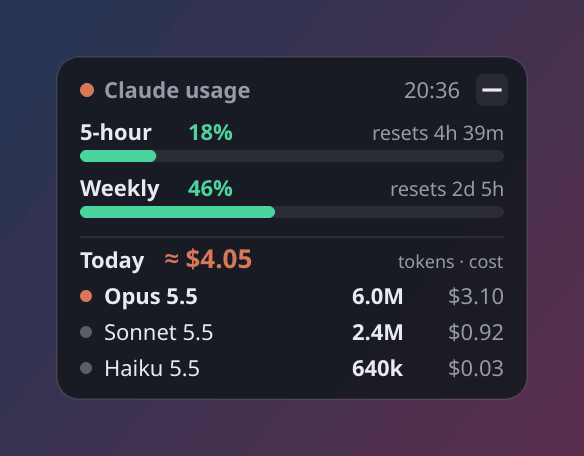
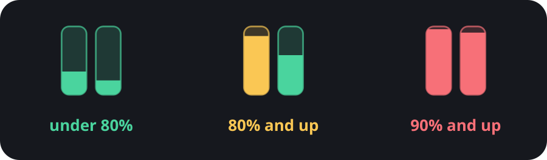
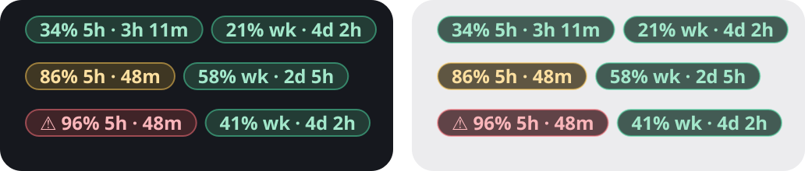
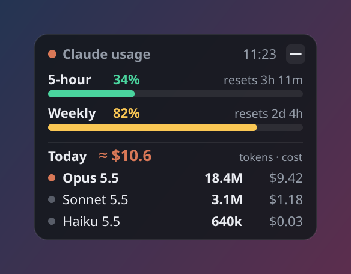

<a id="top"></a>

<p align="center">
  
</p>

<p align="center">
  <a href="https://github.com/vexsadev/claude-usage-widget/actions/workflows/ci.yml"></a>
  
  
  
  
  
  <a href="LICENSE"></a>
</p>

<p align="center">
  <b>See your Claude Code usage live, without typing <code>/usage</code>.</b><br>
  A small widget that floats above your windows and turns green → amber → red as you approach your plan limits.
</p>

<p align="center">
  <a href="#-quick-start">Quick start</a> ·
  <a href="#-install-on-windows">Windows</a> ·
  <a href="#-install-on-macos">macOS</a> ·
  <a href="#-install-on-linux">Linux</a> ·
  <a href="#%EF%B8%8F-using-the-widget">Usage</a> ·
  <a href="#-troubleshooting">Troubleshooting</a> ·
  <a href="#%EF%B8%8F-how-it-works">How it works</a>
</p>

<p align="center">
  
</p>

> [!NOTE]
> This is an unofficial community tool, not made or endorsed by Anthropic. "Claude" is a trademark of Anthropic.

---

## ✨ Features

<table>
  <tr>
    <td width="33%" valign="top">
      <h3>📊 Plan limits</h3>
      Your <b>5-hour</b> and <b>weekly</b> limits, the same numbers as Claude Code's <code>/usage</code>, with a countdown to each reset.
    </td>
    <td width="33%" valign="top">
      <h3>🚦 Traffic-light colors</h3>
      <b>Green</b> under 80%, <b>amber</b> from 80%, <b>red</b> from 90%, and a ⚠ sign from 95%. Used everywhere: widget, tray and top bar.
    </td>
    <td width="33%" valign="top">
      <h3>🔔 Desktop alerts</h3>
      A notification at <b>80%</b> and an urgent one at <b>90%</b> of each limit, once per limit period.
    </td>
  </tr>
  <tr>
    <td valign="top">
      <h3>🧠 Per-model tokens</h3>
      Today's tokens and cost for each model (Opus, Sonnet, Haiku…). A dot lights up while a model is working.
    </td>
    <td valign="top">
      <h3>💵 Today's cost</h3>
      What today's usage would cost at Claude API list prices, with cache reads and writes priced at their own rates.
    </td>
    <td valign="top">
      <h3>📌 Always visible</h3>
      Stays on top, follows you across desktops and Spaces, drags anywhere, remembers its spot, and can be made more see-through.
    </td>
  </tr>
  <tr>
    <td valign="top">
      <h3>🗂️ Tray icon</h3>
      Two stacked number pills (5-hour on top, weekly below) in the Windows and Linux tray, colored like the limits. Hover for reset times, click to show or hide the widget. On macOS, long pills like <code>34% 5h · 3h 11m</code> right in the menu bar.
    </td>
    <td valign="top">
      <h3>🐧 GNOME top bar</h3>
      Optional colored pills like <code>34% 5h · 3h 11m</code> right in the GNOME top bar.
    </td>
    <td valign="top">
      <h3>🔒 Private</h3>
      Runs entirely on your computer. No network requests, no login or API keys read. Starts at login.
    </td>
  </tr>
</table>

### 🎨 Colors at a glance

<p align="center">
  <br>
  <sub>GNOME top-bar pills (Linux, optional)</sub>
</p>

<p align="center">
  <br>
  <sub>Tray icon (Windows, Linux): the top pill is the 5-hour limit, the bottom pill is weekly</sub>
</p>

<p align="center">
  <br>
  <sub>macOS menu bar: the 5-hour and weekly limits with time until reset, on dark and light menu bars</sub>
</p>

| Used | Color | Extra |
|:---:|:---:|---|
| under 80% | 🟢 green | |
| 80 – 89% | 🟡 amber | desktop notification |
| 90% and up | 🔴 red | urgent notification |
| 95% and up | 🔴 red | ⚠ sign next to the number |

---

## 🚀 Quick start

You need **[Claude Code](https://docs.claude.com/en/docs/claude-code/overview)** and **Python 3.9+**. Then:

```bash
git clone https://github.com/vexsadev/claude-usage-widget.git
cd claude-usage-widget
python3 install.py        # Windows: py install.py
```

Open Claude Code (`claude`), send any message, and the limit bars fill in. That's it.

New to the terminal? Follow the step-by-step guide for your system below. 👇

## 📋 Requirements

1. **[Claude Code](https://docs.claude.com/en/docs/claude-code/overview)** installed and signed in.
   - The **plan limits** (5-hour and weekly) only appear if you sign in with a **Claude subscription (Pro or Max)**. If you use Claude Code with an API key, you'll still see tokens and cost, but no limit bars.
2. **Python 3.9 or newer.** The installer creates its own private environment and installs everything else, including the Qt toolkit (a one-time download of about 100 MB).
3. **About 300 MB of disk space.**

---

## 🪟 Install on Windows

**1. Install Python** (skip this if `py --version` already shows 3.9 or newer).
- Download it from <https://www.python.org/downloads/windows/> and run the installer.
- **Tick "Add python.exe to PATH"** on the first screen.
- Or, in PowerShell: `winget install Python.Python.3.13`
- Don't use the **Microsoft Store** version of Python: Windows keeps its files in a private copy where Claude Code can't find the widget. The installer stops and tells you if it detects it.

**2. Download this project.**
- **With Git:** run `git clone https://github.com/vexsadev/claude-usage-widget.git` in PowerShell.
- **Without Git:** click the green **Code** button at the top of this page, choose **Download ZIP**, and extract it, for example to `Downloads\claude-usage-widget`.

**3. Run the installer.** Open **PowerShell** in the project folder (in File Explorer, open the folder, type `powershell` in the address bar and press Enter), then run:

```powershell
py install.py
```

**4. Start a Claude Code session** (`claude`) and send any message. The limit bars fill in after the first reply.

✅ The widget appears in the top-right corner of your screen. Its tray icon is in the bottom-right of the taskbar; if you don't see it, click **^** to show hidden icons, and drag the icon onto the taskbar to keep it there. You'll also find **Claude Usage Widget** in the Start menu.

## 🍎 Install on macOS

**1. Get Python 3 and Git.** Either one works:
- **Apple's developer tools** (simplest): run `xcode-select --install` in Terminal and click **Install**. This provides both `python3` and `git`.
- **Homebrew:** `brew install python git`

**2. Download this project and run the installer** in **Terminal**:

```bash
git clone https://github.com/vexsadev/claude-usage-widget.git
cd claude-usage-widget
python3 install.py
```

**3. Start a Claude Code session** (`claude`) and send any message so the limits appear.

✅ The widget appears in the top-right corner and shows on every Space. The **menu bar** shows two colored pills, like `34% 5h · 3h 11m` and `82% wk · 2d 4h`; click them for the menu. It doesn't add a Dock icon.

> [!TIP]
> **Notifications:** the first alert comes from *Script Editor*. If macOS asks, click **Allow**. If you don't see alerts, check **System Settings → Notifications → Script Editor**.

## 🐧 Install on Linux

**1. Install the system packages.**

<details open>
<summary><b>Ubuntu / Debian</b></summary>

```bash
sudo apt install -y git python3 python3-venv libnotify-bin \
  libxcb-cursor0 libxkbcommon-x11-0 libxcb-icccm4 libxcb-image0 libxcb-keysyms1 libxcb-render-util0 libxcb-xkb1
```
</details>

<details>
<summary><b>Fedora</b></summary>

```bash
sudo dnf install -y git python3 libnotify xcb-util-cursor xcb-util-wm xcb-util-image xcb-util-keysyms xcb-util-renderutil libxkbcommon-x11
```
</details>

<details>
<summary><b>Arch</b></summary>

```bash
sudo pacman -S --needed git python libnotify xcb-util-cursor xcb-util-wm xcb-util-image xcb-util-keysyms xcb-util-renderutil libxkbcommon-x11
```
</details>

**2. Download this project and run the installer:**

```bash
git clone https://github.com/vexsadev/claude-usage-widget.git
cd claude-usage-widget
python3 install.py
```

**3. GNOME only:** log out and back in once. The installer adds a GNOME Shell extension that draws colored limit pills like `34% 5h · 3h 11m` in the top bar, and GNOME (especially on Wayland) only loads new extensions at login. Once the pills are showing, the widget hides its own tray icon.

**4. Start a Claude Code session** (`claude`) and send any message so the limits appear.

<details>
<summary><b>Linux notes: tray icons, other desktops, Wayland</b></summary>

- **Tray icon on GNOME:** GNOME needs an AppIndicator extension to show tray icons. Ubuntu includes one. On Fedora and other distributions, install [AppIndicator and KStatusNotifierItem Support](https://extensions.gnome.org/extension/615/appindicator-support/). Or rely on the top-bar pills; while they're running, the widget hides its own tray icon.
- **KDE, Xfce, Cinnamon** and other desktops show the tray icon out of the box.
- **Wayland:** Wayland doesn't let apps keep their own windows on top, so the widget runs through XWayland (X11 compatibility), where always-on-top works. That's why the X11 (`xcb`) libraries above are needed. If you force native Wayland (`QT_QPA_PLATFORM=wayland`), the widget still runs, but can't stay on top or follow you between workspaces.
- **Library check:** the installer checks that Qt can load the X11 libraries and lists the packages to install if any are missing. On NixOS and Guix it can't check, so it carries on.
</details>

---

## 🖱️ Using the widget

| To... | Do this |
|---|---|
| Move the widget | Drag it with the left mouse button. Its position is remembered. |
| Hide the widget | Click the **–** button at its top-right. It keeps running in the tray. |
| Show it again | Click the tray icon (Windows and Linux) or click the menu-bar pills and choose **Show widget** (macOS), or run `claude-usage-widget` again. |
| Change the transparency | Right-click → **Opacity** |
| Turn start at login on or off | Right-click → **Start at login** |
| Check that notifications work | Right-click → **Test notification** |
| Quit | Right-click → **Quit** |

**Starting it by hand:** it starts at login automatically, but you can also start it yourself.
- **Windows:** Start menu → **Claude Usage Widget**
- **Linux:** the app menu, or `claude-usage-widget` in a terminal
- **macOS:** `"$HOME/Library/Application Support/claude-usage-widget/venv/bin/claude-usage-widget"`

Running it again while it's already running just shows it. Add `--toggle` to show or hide it, or `--quit` to quit it.

### What the numbers mean

<p align="center">
  
</p>

- **5-hour / Weekly:** the percentage of your plan's limit used so far, the same numbers `/usage` shows, and when that limit resets.
- **Today ≈ $X:** what today's Claude Code usage *would* cost at Claude API list prices. **If you're on a subscription, you aren't charged this amount.** It's a guide to how heavy your usage is. It usually comes out a few percent lower than Claude Code's own figure, because some small background requests aren't saved to the session logs. If the total starts with "≥", a model you used isn't in the price list, so the real figure is higher.
- **Model rows:** today's total tokens (input, output and cache) and cost for each model. A highlighted dot means that model was used in the last 2 minutes.

## 🔄 Updating

```bash
cd claude-usage-widget
git pull
python3 install.py        # Windows: py install.py
```

Your settings (position, opacity, start at login) are kept. Re-running the installer is also how you repair an install, for example after a Python upgrade.

## 🗑️ Uninstalling

```bash
cd claude-usage-widget
python3 install.py --uninstall        # Windows: py install.py --uninstall
```

This stops the widget, removes start at login, the Start menu or app-menu entry and the GNOME extension, deletes the app folder, and restores your previous Claude Code status line. Add `--keep-data` to keep your settings.

Uninstalling works even if the widget's own Python environment is broken (for example after Homebrew or your distribution upgraded Python). If your Claude Code settings file can't be read, the uninstaller stops before removing anything and tells you which file to fix.

## 🧰 Installer options

| Option | What it does |
|---|---|
| `--no-autostart` | Don't start the widget at login. |
| `--no-launch` | Don't start the widget after installing. |
| `--no-gnome-extension` | Linux: skip the GNOME top-bar pills. |
| `--skip-lib-check` | Linux: install even if Qt's X11 libraries look missing. |
| `--allow-store-python` | Windows: install with the Microsoft Store Python anyway (not recommended). |
| `--uninstall` | Remove the widget. Add `--keep-data` to keep your settings. |

**Custom app folder:** set `CLAUDE_USAGE_WIDGET_HOME` when you run the installer, for example `CLAUDE_USAGE_WIDGET_HOME=~/apps/claude-usage python3 install.py`. The widget, the status line hook, start at login and the GNOME pills all keep using that folder afterwards, so you don't need to set the variable anywhere else.

---

## 🩺 Troubleshooting

<details>
<summary><b>The limit bars say "waiting for Claude Code".</b></summary>

- The limits come from Claude Code itself. Run `claude`, send a message, and wait for the reply. They only update while a Claude Code session is open.
- Your Claude Code setting must still point at the widget. Open `~/.claude/settings.json` and check that `statusLine.command` contains `claude_usage_widget.statusline`. Running the installer again fixes it.
- Plan limits are only provided for Claude subscription logins (Pro or Max), not for API-key usage.
</details>

<details>
<summary><b>I already had a custom status line.</b></summary>

The installer keeps it. Claude Code runs the widget's hook first, and the hook then runs your original command with **bash**, the same way Claude Code does (Git Bash on Windows), so your terminal still shows your own status line. If your command fails or prints nothing, you see the widget's short line (`Opus 5.5 · 5h 31%`) instead of a blank one. Uninstalling puts your command back.
</details>

<details>
<summary><b>The widget doesn't stay on top or follow me between desktops (Linux).</b></summary>

Make sure the X11 libraries from the Linux install steps are installed, then run the installer again. Some tiling window managers ignore always-on-top requests. In that case, add a floating or sticky rule for the widget window; run `xprop WM_CLASS` and click the widget to find its window class.
</details>

<details>
<summary><b><code>qt.qpa.plugin: Could not load the Qt platform plugin "xcb"</code> (Linux).</b></summary>

Install the libraries listed in the Linux install steps.
</details>

<details>
<summary><b>No tray icon on GNOME.</b></summary>

See the Linux notes above. You need an AppIndicator extension or the included top-bar extension, and you need to log out and back in after installing.
</details>

<details>
<summary><b>"Could not read …/.claude/settings.json" when installing or uninstalling.</b></summary>

Claude Code's settings file isn't valid JSON, often because of a trailing comma or a missing quote. The installer never overwrites a file it can't read, so **nothing was changed**. Fix the file (or move it away), then run the installer again. Files saved by Windows Notepad with a byte-order mark are fine.
</details>

<details>
<summary><b>"This is the Microsoft Store version of Python" (Windows).</b></summary>

The Store version of Python keeps its files and registry changes in a private copy, so Claude Code and start at login wouldn't find the widget. Install Python from [python.org](https://www.python.org/downloads/windows/) or with `winget install Python.Python.3.13`, then run `py install.py` again.
</details>

<details>
<summary><b>"Qt needs some system libraries that are missing" (Linux).</b></summary>

Install the packages the installer lists (they're also in the Linux install steps), then run it again. If you're sure Qt will find them anyway, add `--skip-lib-check`.
</details>

<details>
<summary><b><code>py</code> or <code>python3</code> is not recognized (Windows).</b></summary>

Reinstall Python and tick **Add python.exe to PATH**, or run it with its full path, for example `C:\Users\<you>\AppData\Local\Programs\Python\Python313\python.exe install.py`.
</details>

<details>
<summary><b>I use a custom Claude config folder.</b></summary>

If you set `CLAUDE_CONFIG_DIR`, make sure it's also set when the widget starts at login. The widget looks for logs in `$CLAUDE_CONFIG_DIR/projects`.
</details>

<details>
<summary><b>Prices look wrong.</b></summary>

Prices are in the `PRICES` table at the top of [`src/claude_usage_widget/usage.py`](src/claude_usage_widget/usage.py). Pull requests are welcome when Anthropic changes them.
</details>

---

## ⚙️ How it works

<p align="center">
  
</p>

- **Plan limits:** Claude Code passes JSON to its [status line command](https://docs.claude.com/en/docs/claude-code/statusline) after each turn, and that JSON includes `rate_limits.five_hour` and `rate_limits.seven_day` (`used_percentage`, `resets_at`). The installer registers a small hook as your status line, and the hook saves those values to a file. The hook reads and writes UTF-8 whatever your system's language settings, so names with accents or non-Latin letters work on Windows too.
- **Tokens and cost:** Claude Code saves each session as a JSONL file. The widget reads only the new lines, counts each request's `usage` block once, and prices it by model.
- **Single instance:** starting the widget a second time just shows the copy that's already running, using a local socket.

### File locations

| | 🪟 Windows | 🍎 macOS | 🐧 Linux |
|---|---|---|---|
| App, venv, settings, data | `%LOCALAPPDATA%\claude-usage-widget` | `~/Library/Application Support/claude-usage-widget` | `~/.local/share/claude-usage-widget` |
| Start at login | Registry `HKCU\…\Run\ClaudeUsageWidget` | `~/Library/LaunchAgents/io.github.claude-usage-widget.plist` | `~/.config/autostart/claude-usage-widget.desktop` |
| GNOME top-bar pills | | | `~/.local/share/gnome-shell/extensions/claude-usage@local` |
| Claude Code setting changed | `~/.claude/settings.json` → `statusLine` | same | same |

The installer only changes the `statusLine` entry in Claude Code's settings and keeps everything else. If `settings.json` is a symlink (for example from a dotfiles manager), it writes through the link and keeps it.

## 🔒 Privacy

Everything runs on your own computer. The widget makes **no network requests**, never reads your Claude login or API keys, and only reads Claude Code's local session logs and the limit numbers Claude Code passes to the status line. The only network use is the one-time download of the Python packages during install.

## 🛠️ Development

```bash
python3 -m venv .venv && . .venv/bin/activate       # Windows: .venv\Scripts\activate
pip install -e .
python -m unittest discover -s tests -v             # unit tests (no display needed)
QT_QPA_PLATFORM=offscreen claude-usage-widget --screenshot shot.png   # render with demo data
```

To regenerate the README images (`docs/widget.png`, `docs/demo.gif`, `docs/tray.png`, `docs/menubar.png`) from the real drawing code, and the animated diagram:

```bash
pip install pillow
QT_QPA_PLATFORM=offscreen python docs/make_media.py
python docs/make_diagram.py docs/how-it-works.svg
```

To try the installer or `--setup` / `--teardown` without touching your real Claude Code settings, point both folders somewhere temporary:

```bash
CLAUDE_CONFIG_DIR=$(mktemp -d) CLAUDE_USAGE_WIDGET_HOME=$(mktemp -d) \
  python3 install.py --no-launch --no-autostart --no-gnome-extension --skip-lib-check
```

**Working on this with Claude Code:** the repo includes a Claude Code setup. [`CLAUDE.md`](CLAUDE.md) holds the project rules (standard-library-only modules, Python 3.9 syntax, never touching your real settings, where colors and thresholds are duplicated), and `.claude/` adds shared permissions, a hook that syntax-checks every Python file Claude edits, the `update-prices` and `regen-media` skills, and a `cross-platform-reviewer` agent. Personal overrides go in `.claude/settings.local.json` or `CLAUDE.local.md`, which git ignores.

CI runs the unit tests, the real installer, a headless render, a status line check and the uninstaller on **Windows, macOS and Linux** (Python 3.9 and 3.13; 3.10 and 3.13 on Linux) for every push.

<details>
<summary><b>Project layout</b></summary>

```
src/claude_usage_widget/
  __main__.py    command line (--toggle, --quit, --screenshot, --setup, --teardown)
  app.py         Qt widget, tray icon, single instance
  macbar.py      macOS menu-bar pills (its own NSStatusItem, via pyobjc)
  usage.py       transcript parsing, prices, limits, notifications (standard library only)
  system.py      start at login, status line hook, notifications, window tweaks per OS
  statusline.py  the Claude Code status line hook (standard library only)
  paths.py       per-OS file locations (standard library only)
  demo.py        sample data for screenshots
gnome-extension/claude-usage@local/   optional GNOME top-bar pills
install.py     cross-platform installer and uninstaller (standard library only)
tests/         unit tests (no display or Qt needed)
docs/          README images and the scripts that render them
CLAUDE.md      project guide for Claude Code
.claude/       Claude Code settings, skills and review agent
```
</details>

Contributions are welcome: open an issue or a pull request.

## 📄 License

[MIT](LICENSE). Free to use, modify and share.

---

<p align="center">
  If this widget saves you from hitting a limit mid-task, consider giving it a ⭐<br>
  <sub><a href="#top">Back to top ↑</a></sub>
</p>
